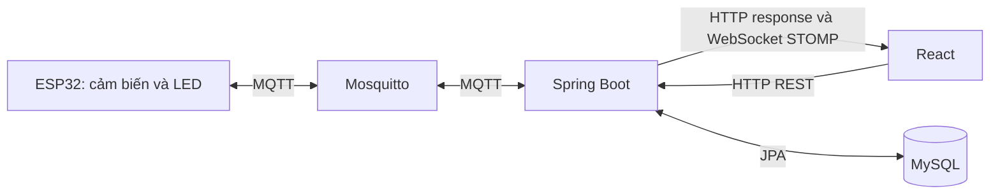

# Luồng chạy các chức năng Smart Home IoT

Đối chiếu mã nguồn hiện tại ngày 13/10/2026. Tài liệu ghi theo dạng **file → hàm → nhiệm vụ → hàm được gọi tiếp**.

## 1. Kiến trúc và cách đọc

- Controller nhận HTTP; service xử lí nghiệp vụ; repository đọc/ghi DB; mapper đổi entity thành DTO.
- Khi gọi `deviceService.control()`, Spring chuyển lời gọi vào implementation `DeviceServiceImpl.control()`.
- Qua mạng là gửi bản tin, không phải Java gọi trực tiếp hàm C++ hoặc JavaScript.
- Event là đối tượng mang dữ liệu. Spring gọi listener đã đăng ký; event không tự gọi listener.
- `@RequiredArgsConstructor` tạo constructor cho dependency final; Spring inject các bean.
- MapStruct sinh implementation mapper khi build. Spring Data cung cấp implementation repository.

| Bảng DB | Entity | Chức năng |
|---|---|---|
| sensors | Sensor.java | Danh mục Temperature/Humidity/Light |
| data_sensors | DataSensor.java | Giá trị đo của từng cảm biến |
| devices | Device.java | Thiết bị và ON/OFF đã lưu |
| action | ActionHistory.java | Lệnh, người thực hiện, thiết bị, kết quả, thời gian |
| users | User.java | Hồ sơ người dùng |

Ba LED: ID 1 = đèn/GPIO23; ID 2 = quạt/GPIO22; ID 3 = điều hòa/GPIO21. DHT11 GPIO4, LDR AO GPIO34.

## 2. Khởi động BE, FE và ESP32

### Backend

| Bước | File → hàm/cấu hình | Mục đích |
|---|---|---|
| 1 | SmartHomeApplication.java → main() → SpringApplication.run() | Spring khởi động và tạo bean theo dependency. |
| 2 | application.properties → MqttProperties, SensorThresholdProperties | Nạp cấu hình MQTT, DB, timeout, ngưỡng. |
| 3 | JpaAuditingConfig.java + BaseEntity.java | Bật auditing; AuditingEntityListener tự điền createdAt cho entity kế thừa BaseEntity. |
| 4 | SchedulingConfig.java → @EnableScheduling | Cho phép Spring tự gọi scheduler. |
| 5 | WebSocketConfig.java → registerStompEndpoints() | Mở endpoint /ws, cấu hình allowed origins. |
| 6 | WebSocketConfig.java → configureMessageBroker() | Bật simple broker /topic và prefix /app. |
| 7 | MqttRestoreConfig.java → mqttRestoreExecutor() | Tạo executor riêng, 1 worker và 20 việc chờ để gửi trạng thái khôi phục. |
| 8 | MqttConfig.java → mqttClient() | Tạo Paho client, cấu hình reconnect, gắn listener bằng setCallback(), gọi connect(). |
| 9 | Paho → MqttMessageListener.java → connectComplete() → subscribeTopic() | Đăng ký sensor/data và device/status/+. |
| 10 | Spring phát ApplicationReadyEvent → StartupLogger.logSwaggerUrl() | Ghi URL Swagger khi ứng dụng sẵn sàng. |

Các hàng là trình tự chức năng, không phải cam kết thứ tự khởi tạo mọi bean.

### Frontend

`main.jsx` render `App()` trong `App.jsx` → `currentPage()` đọc hash URL → chọn Dashboard/DataSensor/History/Profile.

- `changePage()` được gọi khi có `hashchange`, cập nhật trang và đóng menu mobile.
- `Dashboard.jsx → Dashboard()` gọi `useSensorReadings()` và render `SensorStats`, `SensorChart`, `DeviceControls`.
- Dashboard luôn mounted, chỉ bị ẩn khi sang trang khác nên timer/kết nối vẫn hoạt động.
- Các trang còn lại mount lại khi mở; bộ lọc được tạo lại.
- `vite.config.js` chuyển tiếp `/api` và `/ws` sang BE cổng 8080 khi chạy dev server.

### Arduino

Framework Arduino gọi `setup()` một lần và `loop()` lặp lại trong `sketch_sep2a.ino`.

`setup()` → cấu hình GPIO → đặt LED LOW tạm thời → `dht.begin()` → cấu hình MQTT/callback/keepalive → `startWiFi()`.

`loop()` → `maintainConnections()` → `mqttClient.loop()` nếu đã kết nối → kiểm tra retry khôi phục → kiểm tra chu kỳ gửi cảm biến.

## 3. Đo cảm biến → DB → realtime

| Bước | File → hàm | Xử lí và gọi tiếp |
|---|---|---|
| 1 | sketch_sep2a.ino → loop() | Đủ SENSOR_INTERVAL=2000 ms thì gọi publishSensorData(). |
| 2 | publishSensorData() | Gọi dht.readTemperature(), dht.readHumidity(), readEstimatedLux(). |
| 3 | readEstimatedLux() | Đọc ADC/điện áp LDR, tính điện trở và ước tính lux; ngoài vùng hợp lệ trả NAN. |
| 4 | publishSensorData() | Kiểm tra giá trị hữu hạn, độ ẩm 0–100, ánh sáng không âm, giới hạn DB. Lỗi thì bỏ lần gửi. |
| 5 | publishSensorData() → mqttClient.publish() | Gửi JSON temperature/humidity/light tới sensor/data. |
| 6 | Paho → MqttMessageListener.messageArrived() | Nhận topic/payload; parse bằng jsonMapper.readValue(..., SensorMessage.class). |
| 7 | messageArrived() → SensorServiceImpl.saveSensorData() | Mở transaction; gọi validateMessage(). |
| 8 | getSensorByName() → SensorRepository.findByName() | Tìm danh mục ba loại cảm biến. |
| 9 | createDataSensor() ba lần | Làm tròn 2 số thập phân, kiểm tra precision, tạo ba dòng có chung thời gian BE. |
| 10 | DataSensorRepository.saveAll() | Lưu ba dòng data_sensors trong cùng transaction. |
| 11 | DataSensorMapper.toResponse() → resolveUnit() | Đổi entity thành DTO, gắn đơn vị °C/%/lux. |
| 12 | buildLatestResponse() → resolveAlertStatus() | Ghép số đo và cảnh báo. |
| 13 | eventPublisher.publishEvent(new SensorDataSavedEvent(response)) | Phát event nội bộ Spring. |
| 14 | Spring sau commit → SensorWebSocketListener.onSensorDataSaved() | @TransactionalEventListener(AFTER_COMMIT) chỉ gửi sau commit thành công. |
| 15 | onSensorDataSaved() → messagingTemplate.convertAndSend() | Gửi BaseResponse.success(...) tới /topic/sensors. |
| 16 | useSensorReadings.js → callback subscribe /topic/sensors | Parse JSON, kiểm tra success, gọi acceptSnapshot(). |
| 17 | acceptSnapshot() → isSensorSnapshot() → mergeSensorReadings() | Kiểm tra dữ liệu, không để số đo cũ hơn ghi đè số đo mới. |
| 18 | Callback subscribe → appendChartSnapshot() | Nối điểm mới vào biểu đồ. |
| 19 | React render SensorStats() và SensorChart() | Hiện số đo, cảnh báo, mũi tên, biểu đồ mà không F5. |

Ví dụ MQTT: `{"temperature":31.8,"humidity":61,"light":520}`. Một gói chứa ba số đo tạo ba dòng DB. Chu kỳ 2 giây có thể chậm hơn khi thao tác mạng bị chặn. Lux hiện là ước tính, chưa hiệu chuẩn.

## 4. Cảnh báo và mũi tên tăng/giảm

`application.properties` → `SensorThresholdProperties` nạp ngưỡng; `Threshold.isRangeValid()` kiểm tra lower < upper.

| Loại | Lower | Upper |
|---|---:|---:|
| Temperature | 18 °C | 35 °C |
| Humidity | 30% | 80% |
| Light | 100 lux | 1000 lux |

`SensorServiceImpl.buildLatestResponse()` gọi `resolveAlertStatus(reading, threshold)`:

1. Không có số đo: UNKNOWN.
2. Giá trị < lower: LOW; giá trị > upper: HIGH.
3. Còn lại, kể cả bằng ngưỡng: NORMAL.

Kết quả đi trong `SensorLatestResponse`, dùng chung cho REST và WebSocket. FE `SensorStats()` đọc các trường như temperatureAlertStatus, đổi thành “Nhiệt độ cao/thấp”, “Ánh sáng mạnh/yếu” và chọn màu CSS. Không có chức năng tự bật/tắt theo ngưỡng hoặc bảng cảnh báo riêng.

Mũi tên: `SensorStats()` → `chartTimeKey()` + `findLast()` tìm điểm có thời gian trước số đo hiện tại → tính delta=current−previous, làm tròn 2 chữ số. Dương: tăng; âm: giảm; 0: không đổi; chưa có điểm trước: không hiện. Độ ẩm hiển thị chênh lệch bằng điểm %.

## 5. Tải Dashboard ban đầu và biểu đồ

### Số đo mới nhất

1. `Dashboard.jsx → Dashboard()` gọi `useSensorReadings()`.
2. Effect trong `useSensorReadings.js` gọi `refresh()`.
3. `refresh()` → `sensors.js: getLatestSensors()` → `api.js: apiRequest()` → GET `/api/sensors/latest`.
4. `SensorController.getLatest()` → `SensorServiceImpl.getLatest()`.
5. Service gọi `getLatestByName()` cho ba loại → `DataSensorRepository.findFirstBySensor_NameOrderByTimeDescIdDesc()`.
6. Entity qua `DataSensorMapper.toResponse()`; không có số đo thì null.
7. `buildLatestResponse()` ghép cảnh báo; controller bọc BaseResponse.
8. FE `apiRequest()` trả body.data → `acceptSnapshot()` → render thẻ số đo.

### Biểu đồ

1. `useSensorReadings.refreshChart()` gọi song song `sensors.js: getSensorChart()` cho ba loại.
2. `getSensorChart()` → `apiRequest()` → GET `/api/sensors/chart?type=...&limit=100`.
3. `SensorController.getChart()` validate SensorChartRequest → `SensorServiceImpl.getChart()`.
4. Nếu không có hai mốc thời gian, service chọn 1 giờ gần nhất; thiếu một mốc hoặc khoảng đảo thì lỗi.
5. `DataSensorRepository.findChartData()` chạy `DataSensorQueries.CHART`, lọc loại/thời gian, sắp giảm time/id, giới hạn số điểm.
6. `DataSensorMapper.toChartPointResponse()` → `Collections.reverse()` để trả điểm cũ đến mới.
7. FE kiểm tra `isChartPoint()` rồi `mergeChartPoints()` trong sensorChart.js: gộp REST và realtime, bỏ trùng thời gian, giữ 100 điểm cuối mỗi loại.
8. `SensorChart.jsx: SensorChart()` chọn series; `xFor()` đổi thời gian thành X, `yFor()` đổi giá trị thành Y để vẽ SVG.
9. Callback ResizeObserver cập nhật kích thước. `showNearestPoint()` tìm điểm gần con trỏ và hiện tooltip.

Khi có WebSocket mới: `appendChartSnapshot()` → `mergeChartPoints()` → render lại. Khi STOMP nối lại, callback `onConnect()` gọi `refresh()` và `refreshChart()` bù dữ liệu bỏ lỡ. Không gọi REST liên tục mỗi 2 giây để vẽ biểu đồ.

## 6. Tải trạng thái công tắc

1. `DeviceControls.jsx: DeviceControls()` gọi `useDevices()`.
2. Effect trong useDevices.js gọi `refresh()` → `devices.js: getDevices()` → GET `/api/devices`.
3. `DeviceController.getDevices()` → `DeviceServiceImpl.getDevices()` → `DeviceRepository.findAll()` → `DeviceMapper.toResponseList()`.
4. FE `refresh()` gọi `getLastDeviceCommand(device.name)` từng thiết bị: lấy trang 1, size 1, sort id desc từ API lịch sử để xác định PENDING.
5. `refresh()` gọi `getDevices()` lần nữa để lấy trạng thái sau khi đọc lịch sử.
6. `update()` cập nhật React state → `DeviceControls()` render công tắc và pending.

Trạng thái công tắc lấy từ API thiết bị, không lấy action ON của lịch sử SUCCESS cũ ghi đè OFF hiện tại.

## 7. Gửi lệnh bật/tắt một thiết bị

| Bước | File → hàm | Làm gì / gọi tiếp |
|---|---|---|
| 1 | DeviceControls.jsx → callback onClick | Gọi toggle(device.id). |
| 2 | useDevices.js → toggle() → actions.current.toggle() | Tìm trạng thái hiện tại, chọn action ngược lại, gọi send(id,action). |
| 3 | send() | Kiểm tra ready, kết nối WebSocket, pending; đặt sending/pending để hiện “Đang xử lý…”. |
| 4 | devices.js → controlDevice() → apiRequest() | POST /api/devices/{id}/control?action=ON hoặc OFF. |
| 5 | DeviceController.control() | Bind/validate DeviceControlRequest, gọi DeviceServiceImpl.control(). |
| 6 | control() → ActionHistoryRepository.existsByDevice_IdAndStatus() | Nếu có PENDING thì lỗi 409. |
| 7 | control() → DeviceRepository.findById() | Kiểm tra thiết bị; đã đúng trạng thái yêu cầu thì 409 DEVICE_ALREADY_IN_STATE. |
| 8 | control() → UserRepository.findById() | Lấy người thực hiện, hiện cấu hình user-id=1. |
| 9 | control() → ActionHistoryRepository.save() | Tạo history với action, device, user và PENDING; nhận historyId. |
| 10 | control() → mqttClientProvider.getObject().publish() | Gửi historyId/action tới device/control/{id}, QoS 1, không retain. |
| 11 | control() trả DeviceControlResponse → controller | Trả BaseResponse với HTTP 202 Accepted. |
| 12 | FE send() | Gắn historyId vào pending, tiếp tục chờ kết quả. |

Ví dụ payload: `{"historyId":120,"action":"ON"}`. Ở bước gửi, BE chưa đổi devices.status. HTTP 202 chỉ xác nhận đã tiếp nhận/gửi lệnh, chưa xác nhận LED thực hiện.

## 8. Thực hiện lệnh → ACK → DB → WebSocket

| Bước | File → hàm | Làm gì / gọi tiếp |
|---|---|---|
| 1 | sketch_sep2a.ino → loop() → mqttClient.loop() | Thư viện đọc tin, gọi mqttCallback(). |
| 2 | mqttCallback() | Nhận topic /1, /2, /3; parse JSON, kiểm tra historyId và action. |
| 3 | mqttCallback() | Nếu statesRestored=false thì publishDeviceStatus(...,ERROR) và return. |
| 4 | getLedPin() → digitalWrite() | ON=HIGH, OFF=LOW tại GPIO tương ứng. |
| 5 | digitalRead() | So với targetLevel, chọn SUCCESS hoặc ERROR. |
| 6 | publishDeviceStatus() → mqttClient.publish() | Gửi device/status/{id} với historyId/action/status. |
| 7 | MqttMessageListener.messageArrived() → handleDeviceAck() | extractDeviceId() lấy ID cuối topic; parse DeviceAckMessage; validator.validate(). |
| 8 | handleDeviceAck() → DeviceServiceImpl.acknowledge() | Mở transaction, kiểm tra tham số. |
| 9 | acknowledge() → ActionHistoryRepository.findWithLockById() | Khóa ghi history, tránh ACK và timeout cùng hoàn tất một dòng. |
| 10 | acknowledge() | Kiểm tra đúng device/action; history không còn PENDING thì bỏ qua ACK trùng/muộn. |
| 11 | history.setStatus() | Cập nhật SUCCESS/ERROR; chỉ SUCCESS mới device.setStatus(ON/OFF). |
| 12 | publishCommandStatus() → DeviceMapper.toCommandStatusResponse() | Tạo kết quả gồm historyId/deviceId/action/status/deviceStatus. |
| 13 | publishCommandStatus() → eventPublisher.publishEvent() | Phát DeviceCommandStatusChangedEvent trong transaction. |
| 14 | Transaction commit | JPA dirty checking ghi entity đã thay đổi; không nhất thiết gọi save lần nữa. |
| 15 | Spring → DeviceWebSocketListener.onCommandStatusChanged() | AFTER_COMMIT → convertAndSend tới /topic/devices. |
| 16 | useDevices.js → callback subscribe → acceptResult() | Validate, bỏ kết quả đã xử lí, cập nhật status/pending/notices. |
| 17 | DeviceControls() → DeviceNotice() | Hiện kết quả; thành công 1 giây, lỗi 5 giây, 200 ms cuối mờ đi. |

Ví dụ ACK: `{"historyId":120,"action":"ON","status":"SUCCESS"}`.

`digitalRead()` chỉ xác nhận mức logic GPIO, không xác nhận LED vật lí phát sáng. `MqttMessageListener.deliveryComplete()` không cập nhật SUCCESS: MQTT delivery completion không phải ACK nghiệp vụ.

## 9. Chờ phản hồi, lỗi publish và thứ tự HTTP/WebSocket

- `send()` đặt pending ngay khi gửi; “Đang xử lý…” không phải thời gian cố định 0,5 giây.
- `acceptResult()` nhận kết quả WebSocket. Map `completed` giữ historyId đã xong.
- Nếu ACK đến trước HTTP, khi HTTP về `send()` so completed để không đặt lại PENDING.
- `revision` ngăn refresh cũ ghi đè dữ liệu mới; khi POST vẫn sending thì refresh giữ pending đó.
- Timer 5 giây trong `useDevices()` gọi refresh nếu có pending hoặc chưa ready để bù phản hồi WebSocket bị lỡ.
- POST lỗi mạng: đánh dấu uncertain và refresh; không tự POST lại vì BE có thể đã nhận lệnh.
- BE publish ném MqttException: `DeviceServiceImpl.control()` → `markPublishFailed()` → TransactionTemplate với REQUIRES_NEW → findWithLockById() → nếu PENDING thì ERROR → publishCommandStatus() → WebSocket sau commit. Sau đó trả lỗi HTTP 503 MQTT_PUBLISH_FAILED.

## 10. Timeout

1. Spring scheduler tự gọi `DeviceCommandTimeoutScheduler.checkTimeouts()` nhờ @Scheduled; không cần controller gọi.
2. Cấu hình hiện tại: chờ lệnh 30 giây; quét sau mỗi lần trước hoàn tất 5 giây, initial delay 5 giây.
3. `checkTimeouts()` tính cutoff=now−30 giây.
4. `DeviceServiceImpl.findExpiredCommandIds(cutoff)` → `ActionHistoryRepository.findExpiredIds(PENDING,cutoff,PageRequest.of(0,100))`.
5. `ActionHistoryQueries.FIND_EXPIRED_IDS` chọn createdAt<=cutoff, cũ trước, tối đa 100 ID.
6. Scheduler lặp gọi `deviceService.timeoutCommand(id,cutoff)`, mỗi lần có transaction riêng.
7. `timeoutCommand()` → findWithLockById() → kiểm tra lại tồn tại/PENDING/thời gian → setStatus(ERROR) → publishCommandStatus().
8. Commit → DeviceWebSocketListener → /topic/devices → FE acceptResult() → bỏ chờ, hiện lỗi.

Cutoff chung cho một lượt, mỗi history có createdAt riêng để so. Không đổi thiết bị thành OFF khi timeout. ACK đến sau ERROR hiện bị bỏ. Thời điểm phát hiện có thể muộn hơn 30 giây do chu kỳ quét và tải xử lí.

## 11. Bật/tắt tất cả

`DeviceControls` callback nút → `useDevices.toggleAll()` → `actions.current.toggleAll()`:

1. Có pending hoặc không có thiết bị thì return.
2. Tất cả ON thì chọn OFF; ngược lại chọn ON.
3. Lọc thiết bị chưa ở trạng thái yêu cầu.
4. Mỗi thiết bị gọi riêng `send(id,action)` và đi qua mục 7–10.

Mỗi thiết bị có historyId và kết quả riêng. Code hiện tại không dùng device/control/all và không gộp thành một transaction chung.

## 12. Mất nguồn/Wi-Fi → cảnh báo

1. `sketch_sep2a.ino: maintainConnections()` → mqttClient.connect() đăng ký Last Will OFFLINE trên device/status/connection, QoS 1, không retain.
2. Rút nguồn: ESP32 không còn chạy để gửi tin; broker phát Last Will khi phát hiện kết nối mất.
3. `MqttMessageListener.messageArrived()` nhận OFFLINE → log WARN → `DeviceConnectionNotifier.notifyStatus("OFFLINE")`.
4. `notifyStatus()` lưu biến status trong RAM → convertAndSend /topic/device-connection.
5. `useDevices.js` callback subscribe → `acceptConnection()` → cập nhật boardConnection.
6. `DeviceControls()` tính connectionMessage → hiện khung cảnh báo; CSS trong device-controls.css.

Keepalive Arduino là 10 giây; thông báo có độ trễ, không tức thì. Khi mất Wi-Fi, sketch gọi wifiClient.stop() thay vì MQTT DISCONNECT để không chủ động hủy Last Will.

Thông báo không đổi ON/OFF trong DB và hiện không khóa điều khiển dựa trên boardConnection. Điều kiện khóa của FE là ready/kết nối WebSocket/pending.

### Tải lại trang

`useDevices.onConnect()` → `loadConnection()` → GET /api/devices/connection → `DeviceController.getConnection()` → `DeviceConnectionNotifier.getStatus()` → FE acceptConnection(). connectionVersion ngăn REST cũ ghi đè tin WebSocket mới.

### BE mất kết nối broker

Paho → `MqttMessageListener.connectionLost()` → log → notifyStatus(UNKNOWN). Không kết luận ESP32 tắt chỉ vì BE mất broker. Khi nối lại, connectComplete() subscribe lại.

## 13. Cắm lại → khôi phục LED theo DB

| Bước | File → hàm | Nhiệm vụ |
|---|---|---|
| 1 | sketch_sep2a.ino → setup() | Tạm đặt LED LOW và nối Wi-Fi. |
| 2 | loop() → maintainConnections() | Nối MQTT, subscribe device/control/+. |
| 3 | maintainConnections() | statesRestored=false; sinh restoreRequestId mới 16 ký tự hex. |
| 4 | requestSavedStates() | Gửi requestId tới device/status/restore. |
| 5 | MqttMessageListener.messageArrived() | Nếu không phải retained thì gọi stateRestorer.restore(payload). |
| 6 | DeviceStateRestorer.restore() | Kiểm tra mã, executor.execute() giao việc cho worker. |
| 7 | Worker từ MqttRestoreConfig.mqttRestoreExecutor() | Chạy ngoài MQTT callback thread để không chờ publish/PUBACK trên luồng nhận tin. |
| 8 | Lambda trong restore() → DeviceServiceImpl.getDevices() | Repository.findAll() → mapper.toResponseList(); đọc DB. |
| 9 | restore() | Lọc ID 1–3, kiểm tra đủ ba ON/OFF, tạo JSON requestId/states. |
| 10 | clientProvider.getObject().publish() | Gửi device/control/restore, QoS 1, không retain. |
| 11 | ESP32 mqttClient.loop() → mqttCallback() | Nhận nhánh restore, gọi restoreSavedStates(). |
| 12 | restoreSavedStates() | Bỏ nếu đã khôi phục; kiểm tra JSON/requestId và đủ ba trạng thái. |
| 13 | getLedPin() → digitalWrite() → digitalRead() | Đặt ON/OFF theo DB, kiểm tra mức GPIO. |
| 14 | restoreSavedStates() | Đặt statesRestored=true, publish ONLINE. |
| 15 | MqttMessageListener → DeviceConnectionNotifier → FE acceptConnection() | Bỏ cảnh báo mất kết nối. |

Ví dụ phản hồi: `{"requestId":"0123456789abcdef","states":{"1":"ON","2":"OFF","3":"ON"}}`.

Chưa xong: loop() thử requestSavedStates() mỗi 5 giây. ID mới giúp bỏ phản hồi lần kết nối cũ; statesRestored giúp bỏ phản hồi trùng sau khi đã xong. Luồng này chỉ đọc DB, không tạo history, không dùng DeviceCommandStatusChangedEvent. Thực hiện mỗi lần MQTT reconnect; đèn khôi phục sau khi kết nối thành công, không ngay lúc vừa cấp nguồn.

## 14. Tìm kiếm dữ liệu cảm biến, lọc ngày, phân trang

| Bước | File → hàm | Xử lí |
|---|---|---|
| 1 | DataSensor.jsx → DataSensor() | State field/query/search/page/size/dateRange, mặc định trang 1 và 20 dòng. |
| 2 | Callback ô nhập/chọn loại | Cập nhật bản nháp query/field, chưa tìm ngay khi gõ. |
| 3 | submitSearch() | preventDefault(), chốt search, page=1, retry(). |
| 4 | sensorSearch.js → buildSensorSearchParams() | Tạo pageRequest/searchRequest; nhận diện tên loại Việt/Anh đầy đủ khi chọn all. |
| 5 | useSensorSearch.js → useSensorSearch() | sensorSearchQuery() tạo query; effect gọi hàm nội bộ load(). |
| 6 | sensors.js → getSensorPage() → apiRequest() | GET /api/sensors với tham số phân trang/bộ lọc. |
| 7 | SensorController.search() → SensorServiceImpl.search() | Bind/validate DTO và kiểm tra khoảng ngày. |
| 8 | search() → buildKeywordPattern() | Trim/lowercase, bỏ # đầu ID, escape %, _, !; đổi ngày thành thời gian. |
| 9 | PageableSearchUtils.search() → toPageable() | Kiểm tra page/size/sort, đổi trang 1-based sang 0-based. |
| 10 | Lambda finder → DataSensorRepository.search() | Chạy DataSensorQueries.SEARCH và COUNT_SEARCH. |
| 11 | entityPage.map(dataSensorMapper::toResponse) → PageResponse.from() | Trả items/page/size/totalElements/totalPages. |
| 12 | Controller bọc BaseResponse → FE load() → setResult() | Hiện dữ liệu bảng. |
| 13 | DataSensor() | formatSensorTime()/formatSensorValue(), ScrollableTable(), Pagination(). |

- Không chọn ngày: sensorSearchQuery() bỏ giá trị trống; BE nhận null, không lọc ngày.
- Chỉ có một ngày hoặc ngày đầu lớn hơn ngày cuối: BE báo lỗi.
- Khoảng hợp lệ: startDate đầu ngày; endDate lấy đầu ngày kế tiếp, điều kiện `< endTimeExclusive` để bao trọn ngày cuối.
- DateRangeCalendar.choose() → onChange/setDraftDates(); bấm áp dụng → DataSensor.applyDateRange() → setDateRange/page=1 → tải lại.
- moveMonth()/showField() điều hướng lịch. clearDateRange() bỏ ngày; clearSearch() bỏ các bộ lọc.
- Pagination.onChange → setPage(); onSizeChange → setSize()/page=1 → hook gọi API lại.
- Hook hủy request cũ, timeout 10 giây, có retry; response cũ không đè bộ lọc mới.
- searchSensorRows() còn trong util là helper lọc local cũ, không phải luồng chính hiện tại. Lọc/phân trang thực tế chạy ở BE.

## 15. Xem và lọc lịch sử

1. `History.jsx: History()` giữ query thời gian/device/action/status/page/size.
2. Callback thay đổi bộ lọc cập nhật state và page=1.
3. `useHistorySearch(params)` → `history.js: historySearchQuery()` → effect chờ 300 ms → hàm nội bộ load().
4. `getHistoryPage()` → apiRequest() → GET /api/action-history; sort createdAt desc.
5. `ActionHistoryController.search()` → `ActionHistoryServiceImpl.search()`.
6. `buildTimePattern()` tạo LIKE cho thời gian; all đổi thành null ở các bộ lọc còn lại.
7. `PageableSearchUtils.search()` → toPageable() → lambda → `ActionHistoryRepository.search()`.
8. `ActionHistoryQueries.SEARCH/COUNT_SEARCH` lọc dữ liệu; EntityGraph nạp device và user.
9. `ActionHistoryMapper.toResponse()` đổi createdAt→time, user.name→operator, device.name→device.
10. PageResponse.from() → BaseResponse → FE load()/setResult() → bảng, nhãn trạng thái, phân trang.

Có ba trạng thái PENDING/SUCCESS/ERROR. Hook có debounce, abort request cũ, timeout, retry. Trang History không subscribe realtime; tải lại khi mở, đổi bộ lọc/trang hoặc retry.

## 16. Hồ sơ user 1 và tài nguyên

1. `App.jsx` chọn #profile → `Profile.jsx: Profile()` mount.
2. Effect theo attempt → apiRequest('/api/profile/1'), timeout 10 giây.
3. `UserController.getProfile(id)` → `UserServiceImpl.getProfile(id)`.
4. Service kiểm tra id>0 → UserRepository.findById(); không có trả 404.
5. `UserMapper.toResponse()` trả id/name/studentId/email/phone/githubLink/figmaLink/apiDocsLink.
6. Controller bọc BaseResponse; FE kiểm tra data.id=1 → setProfile().
7. `ProfileSummary()` hiện tên; `ContactInformation()` hiện liên hệ, mailto/tel.
8. `ResourcesSection()` → `safeResourceUrl()` → `ResourceCard()` hiển thị link DB; chỉ nhận http/https, thiếu link thì không tạo liên kết bấm.

Ảnh đại diện, dòng mô tả trường học và PDF vẫn là nội dung/tệp sẵn trên FE. Chưa có luồng sửa hồ sơ hay đăng nhập nhiều người dùng.

Lỗi lúc tải: catch → setError → khung lỗi; nút thử lại tăng attempt → effect chạy lại. Cleanup abort request khi rời trang. Trang không polling phát hiện BE chết sau khi đã tải hồ sơ thành công.

## 17. Phân trang và lỗi chung

`PageableSearchUtils.search()` gọi `toPageable()` kiểm tra page>=1, size 1–100, sortBy trong danh sách cho phép, sortDir asc/desc. Nếu sortBy khác id, thêm id để thứ tự ổn định. Gọi finder.apply(pageable), map entity sang DTO rồi PageResponse.from(). PageResponse trả lại số trang 1-based.

| Lỗi HTTP | GlobalExceptionHandler.java → hàm | Kết quả |
|---|---|---|
| BusinessException | handleBusinessException() | Status/code/message nghiệp vụ |
| Validation DTO | handleValidationException() | 400 VALIDATION_ERROR |
| Body không đọc được | handleInvalidBody() | 400 INVALID_REQUEST_BODY |
| Sai kiểu tham số | handleTypeMismatch() | 400 PARAMETER_TYPE_MISMATCH |
| Lỗi khác | handleUnexpectedException() | Log chi tiết, trả 500 thông báo chung |

`api.js: apiRequest()` gọi fetch, đọc JSON, kiểm tra HTTP và body.success. Thành công trả body.data; lỗi ném ApiError có status/code/message để hook/trang hiển thị.

MQTT: messageArrived() log và bỏ JSON sai hoặc BusinessException 4xx; lỗi nghiệp vụ 5xx/lỗi khác được log rồi ném tiếp. GlobalExceptionHandler xử lí HTTP, không tự gửi HTTP response cho ESP32.

WebSocket: useSensorReadings và useDevices có hai STOMP Client riêng. onWebSocketClose/onWebSocketError cập nhật mất kết nối; reconnectDelay=5000, connectionTimeout=10000; onConnect subscribe lại rồi tải REST. Cleanup hủy request/timer/client khi unmount.

## 18. Event, trạng thái và topic cần phân biệt

| Event | Nơi phát | Listener sau commit |
|---|---|---|
| SensorDataSavedEvent | SensorServiceImpl.saveSensorData() | SensorWebSocketListener.onSensorDataSaved() → /topic/sensors |
| DeviceCommandStatusChangedEvent | DeviceServiceImpl.publishCommandStatus() | DeviceWebSocketListener.onCommandStatusChanged() → /topic/devices |

DeviceConnectionNotifier được MQTT listener gọi trực tiếp, không dùng hai event trên.

| Khái niệm | Ý nghĩa |
|---|---|
| Action ON/OFF | Thao tác yêu cầu |
| DeviceStatus ON/OFF | Trạng thái BE đã lưu |
| ActionStatus | PENDING/SUCCESS/ERROR của một lệnh |
| ONLINE/OFFLINE/UNKNOWN | Kết nối gần nhất BE biết, lưu RAM |
| DeviceControlResponse | Response HTTP tiếp nhận lệnh |
| DeviceCommandStatusResponse | Kết quả cuối cùng và deviceStatus qua WebSocket |

| HTTP | Controller → hàm |
|---|---|
| GET /api/sensors | SensorController.search() |
| GET /api/sensors/latest | SensorController.getLatest() |
| GET /api/sensors/chart | SensorController.getChart() |
| GET /api/devices | DeviceController.getDevices() |
| POST /api/devices/{id}/control | DeviceController.control() |
| GET /api/devices/connection | DeviceController.getConnection() |
| GET /api/action-history | ActionHistoryController.search() |
| GET /api/profile/{id} | UserController.getProfile() |

| MQTT topic | Chiều | Nội dung |
|---|---|---|
| sensor/data | ESP32→BE | Ba số đo |
| device/control/{1,2,3} | BE→ESP32 | historyId/action |
| device/status/{1,2,3} | ESP32→BE | ACK |
| device/status/connection | ESP32/broker→BE | ONLINE/OFFLINE |
| device/status/restore | ESP32→BE | requestId |
| device/control/restore | BE→ESP32 | requestId và states |

Dấu + trong device/status/+ hoặc device/control/+ khớp một cấp. Nhánh restore/connection phải phân loại trước nhánh ID số. BE publish control/restore QoS 1; Last Will QoS 1; các publish thường của PubSubClient trong sketch hiện tại là QoS 0. Subscribe QoS 1 không nâng publish QoS 0 thành 1.

WebSocket: /ws là endpoint; /topic/sensors là snapshot/cảnh báo; /topic/devices là kết quả lệnh; /topic/device-connection là trạng thái kết nối.

## 19. Các giới hạn cần trình bày đúng

1. HTTP 202 và MQTT delivery complete không xác nhận LED thực hiện; cần ACK nghiệp vụ có historyId.
2. Kiểm tra PENDING chưa khóa toàn bộ chuỗi check–insert theo device, nên chưa chống triệt để hai request đồng thời từ hai tab. Khóa history dùng cho ACK/timeout.
3. ACK muộn sau ERROR bị bỏ. Không khẳng định đã đồng bộ mọi tình huống ACK muộn.
4. Mất điện không đổi DB thành OFF; cắm lại khôi phục theo DB. Khôi phục cần BE, DB, broker và mạng hoạt động.
5. Trạng thái kết nối lưu RAM và bản tin không retain; BE restart có UNKNOWN, có thể bỏ lỡ sự kiện khi không nghe MQTT.
6. Cảnh báo kết nối hiện không chặn điều khiển theo ONLINE/OFFLINE; cảnh báo ngưỡng không tự bật/tắt thiết bị.
7. GPIO readback không chứng minh LED vật lí sáng. LDR lux chưa hiệu chuẩn.
8. Profile dùng ID 1 cố định; không coi đây là xác thực người dùng.
9. Trong SensorServiceImpl.validateMessage(), nhánh ánh sáng âm đang dùng mã/message INVALID_HUMIDITY; đây là tên lỗi chưa chuẩn, không phải quy tắc ánh sáng khác.
10. DeviceStateRestorerTest kiểm tra payload/state, request sai, thiếu thiết bị và Spring context có executor. Test không thay thế thử phần cứng thật.

## 20. Thứ tự demo đề xuất

1. Dashboard: REST tải snapshot, WebSocket cập nhật số đo và biểu đồ.
2. Tác động cảm biến: publishSensorData → saveSensorData → event → onSensorDataSaved → acceptSnapshot.
3. Bật LED: toggle → send → control → mqttCallback → acknowledge → onCommandStatusChanged → acceptResult.
4. Bật tất cả: từng lệnh riêng, historyId riêng.
5. Mở lịch sử và dữ liệu cảm biến: lọc, khoảng ngày rỗng/có ngày, phân trang BE.
6. Rút nguồn: Last Will, cảnh báo; lệnh không ACK đi tới ERROR.
7. Cắm lại: requestId → đọc DB → restoreSavedStates → ONLINE.
8. Hồ sơ: GET user 1, phân biệt trường DB và ảnh/PDF tĩnh.

## 21. Vị trí mã nguồn

- BE: `D:/smart-home/smart-home/src/main/java/com/loc/smart_home/`.
- Controllers/services/repositories/mappers/entities nằm dưới `modules/{sensor,device,actionhistory,user}/`.
- MQTT: `integration/mqtt/`; WebSocket: `integration/websocket/`; cấu hình chung: `config/`.
- FE: `C:/Users/ASUS/Downloads/iot-ui-task3/iot-ui/src/`, chia `pages/`, `components/`, `hooks/`, `services/`, `utils/`.
- Firmware: `D:/IoTSoft/sketch_sep2a/sketch_sep2a.ino`.
